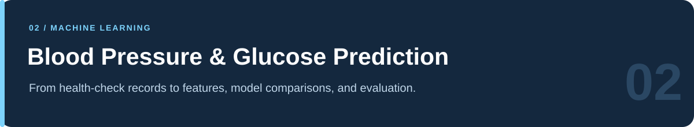
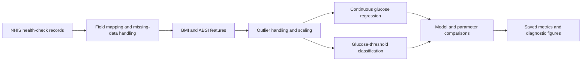
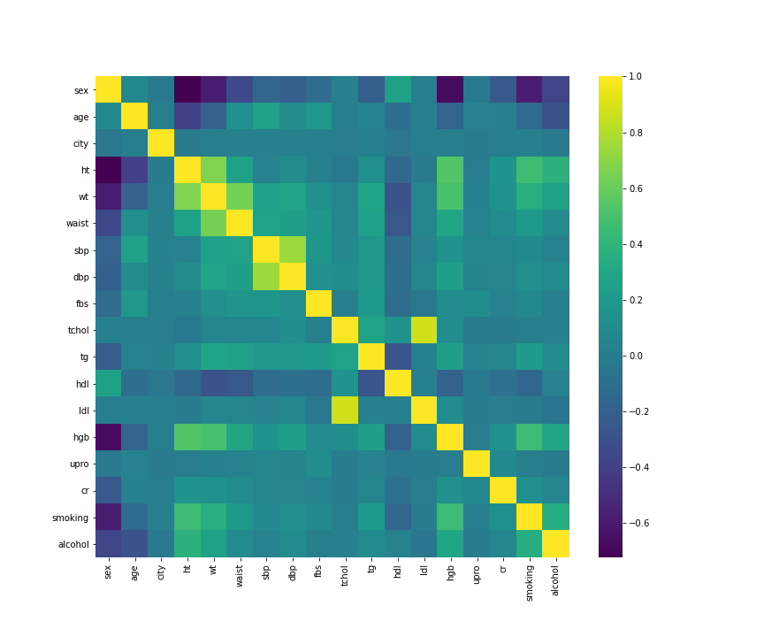

  

# Blood Pressure & Glucose Level Prediction

**Health-data exploration, feature engineering, and predictive model comparison**

MultiCampus · K-Digital Training · Autumn 2021

[Portfolio home](../README.md) · [Results & sources](../docs/PROJECT_EVIDENCE.md#health-prediction) · [Reproduction guide](../docs/REPRODUCIBILITY.md#health-prediction) · [Complete catalog](../docs/NOTEBOOK_CATALOG.md)

---

## At a glance

| Item | Description |
|---|---|
| **Team objective** | Explore an accessible prediction prototype using demographic, body-measurement, and lifestyle information. |
| **Targets** | Blood pressure and fasting glucose in the broader project; continuous glucose and glucose-threshold classification in the representative archived notebooks. |
| **Data source** | South Korea's National Health Insurance Service, as identified in the code and project brief. |
| **My recorded role** | Team leader and blood-pressure prediction analyst, according to the project brief. |
| **Preserved work** | Data overview, correlation figures, feature engineering, regression/classification comparisons, and parameter-search experiments. |
| **Recognition** | Excellent Project Achievement for the machine/deep-learning project, recorded in my 2023 CV. |
| **Review status** | Source and selected saved outputs inspected; no clinical validation or fresh model rerun is claimed. |

## Project context and contribution

The team project had three components: **blood-pressure prediction, glucose prediction, and a web interface**. The project brief records my responsibility for team leadership and blood-pressure modeling, with the interface developed by another team member.

This folder preserves a substantial set of **glucose-model experiments** under filenames carrying my Korean name, 천준. The code documents data preparation, feature construction, continuous-value regression, and several classification definitions. These artifacts support a detailed explanation of the analytical work; they do not establish that every model or the final web application is included here.

The project brief dates the work to **September–October 2021**; the 2024 résumé uses **August–October 2021**. The broader “Autumn 2021” label avoids concealing that small source difference. See the [background register](../docs/PROJECT_EVIDENCE.md#author-provided-background).

## Data and features

The representative notebook reads `NHIS_OPEN_GJ_2017_v1.1.csv` using `encoding='cp949'`. It maps Korean field names to shorter analytical variables.

| Feature group | Variables visible in the notebook |
|---|---|
| Demographic | Sex code, five-year age-group code, regional code |
| Body measurements | Height, weight, waist circumference |
| Lifestyle | Smoking status and alcohol indicator |
| Additional health fields | Systolic/diastolic pressure, cholesterol measures, triglycerides, hemoglobin, urine protein, creatinine |
| Engineered features | `bmi` and an `absi` feature using the archived waist/height formula |
| Glucose outcomes | Continuous fasting-glucose value `fbs` and derived threshold labels |

The representative limited-input models use **eight baseline features**—age, sex, region, height, weight, waist, smoking, and alcohol—and add BMI/ABSI in extended variants. Other measured health fields appear in exploratory correlations and preprocessing.

### Two different prediction tasks

| Task | Target definition in the archive | Suitable interpretation |
|---|---|---|
| **Regression** | Continuous `fbs` | Error in the target's original units, or explicitly identified scaled units. |
| **Classification** | Labels generated with `np.digitize` | Accuracy, confusion matrix, precision, and recall for that particular label definition. |

The consolidated notebook creates `fbs_L` using thresholds `[99, 125, 200, 999]`, `fbs_L2` using `[125]`, and `fbs_L3` using `[99]`. These are **the notebook's encoded tasks**, not an independent clinical interpretation. Accuracy from one task should not be substituted for another.

## Analytical workflow

### Preparation and exploration

The notebooks examine correlations, compare distributions across age groups, construct body-measurement features, and apply IQR-based outlier filters. They explore unscaled, standardized, and min-max-transformed variants.

### Model families preserved here

| Family | Observed use |
|---|---|
| Linear regression / statsmodels OLS | Continuous glucose baselines and alternative feature formulas. |
| Logistic regression | A binary glucose-threshold experiment at the end of the consolidated notebook. |
| Decision trees | Both classification and regression variants; feature-importance plots. |
| Random forests | Classification/regression, feature importance, and loops over tree counts, depths, and feature counts. |
| Parameter search | Grid/search experiments using saved comparison tables and external CSV outputs. |

The broader project brief also names LightGBM and other models. Those final-component claims are reported separately below; LightGBM is not presented as an implementation verified in the representative notebooks.

## Results: reported project outcomes

The following values come from the author's **Blood Pressure and Glucose Level Prediction** project brief, page 3. They are historical reported outcomes, not fresh reproductions of the final models.

| Component | Accuracy | Precision | Recall | F1 | Regression error reported |
|---|---:|---:|---:|---:|---|
| Blood pressure | 79% | 50% | 66% | 57% | Systolic RMSE 13.07; diastolic RMSE 9.18 |
| Glucose | 91% | 55% | 59% | 57% | RMSE 23.03 |

The brief identifies LightGBM as the best blood-pressure model and describes a team-built user-input interface. Its table does not fully specify the classification label definitions, sample selection, or evaluation protocol. The README therefore preserves the reported values with their provenance and does not equate the classification metrics with continuous-measurement accuracy.

The physical units of the reported RMSE values have not been independently verified in this review. For the saved glucose regressions below, RMSE is on the notebook's `fbs` scale; standardized-target MSE is identified separately.

## Results: directly visible saved experiments

These examples are from [the consolidated glucose notebook](<(종합)혈당수치예측_천준.ipynb>) and [the compact random-forest study](Data_modeling_the_best_model_천준.ipynb). Cell numbers are one-based positions in the notebook file, including Markdown cells.

| Experiment | Saved value | Context |
|---|---:|---|
| Eight-feature linear glucose regression | RMSE **22.3340** | Consolidated notebook, cells 54–57; 30% test split, `random_state=2045`. |
| Extended OLS with BMI/ABSI | RMSE **22.3322** | Consolidated notebook, cells 66–69; a separate feature variant. |
| Binary logistic glucose classification | Accuracy **0.922806** | Consolidated notebook, cells 177–181; `fbs_L2`, threshold 125, standardized feature variant. |
| Random-forest regression | MSE **0.910597** | Compact study, cells 37–41; target is standardized. This is not raw-unit RMSE. |

These examples show what is present in the archive. They do not identify a single revalidated “best final model.” Reported 91% glucose accuracy and the saved 92.28% experiment have different source contexts.

## Archived visual exploration

  

*Original repository figure: exploratory correlations among the mapped health variables. Correlation is descriptive and does not establish predictive performance or causality.*

<table>
  <tr>
    <td width="50%" align="center"> Age-group and body-shape-index exploration</td>
    <td width="50%" align="center"> Age-group and body-mass-index exploration</td>
  </tr>
</table>

Original figure filenames and spellings are preserved. Additional heatmaps are [heatmap기본.png](heatmap기본.png), [heatmap연령별로.png](heatmap연령별로.png), and [heatmap전체.png](heatmap전체.png).

## Recommended reading order

This sequence is for reviewing the experiments. The notebooks share and repeat preparation blocks; they are not a verified pipeline of scripts to execute in order.

| Step | Notebook | Focus |
|---|---|---|
| 1 | [Data overview](Data_overview_천준.ipynb) | Original fields, data mapping, and preliminary relationships. |
| 2 | [Consolidated glucose experiments](<(종합)혈당수치예측_천준.ipynb>) | The most comprehensive preserved comparison of regression and threshold-classification tasks. |
| 3 | [Linear regression study](Data_modeling_linear_regression_천준.ipynb) | Feature formulas, OLS, and continuous glucose baselines. |
| 4 | [Decision-tree study](Data_modeling_Decision_Tree_천준.ipynb) | Tree-model preparation and comparisons. |
| 5 | [Random-forest study](Data_modeling_Random_Forest_천준.ipynb) | Forest variants and feature importance. |
| 6 | [Combined LR/DT/RF study](Data_modeling_LR_DT_RF천준.ipynb) | Extended comparison across model families. |
| 7 | [Compact forest study](Data_modeling_the_best_model_천준.ipynb) | A focused parameter configuration and standardized-target results. |

<b>Other preserved variants</b>

- [Modeling and visualization notebook](Data_modeling_visualization_천준.ipynb): extended experiment and plotting variant.
- [Decision_Tree.ipynb](Decision_Tree.ipynb): an additional tree notebook.
- Three tracked checkpoint copies: preserved and listed in the [complete catalog](../docs/NOTEBOOK_CATALOG.md).

## Reproduction and evaluation boundaries

| Issue | Why it matters |
|---|---|
| **2017 versus 2020 inputs** | The code references a 2017 NHIS CSV. The local `DataSets/` filenames identify 2020 material, which is not a verified drop-in replacement. |
| **External files and paths** | Notebook paths point to Colab Drive and historical `c:/My_data/` locations. Parameter-search CSVs are also referenced. |
| **Scaling before splitting** | Representative preparation fits scalers before the later train/test split. A fresh evaluation should fit transformations on training data only. |
| **Repeated test-set comparison** | Parameter variants are evaluated against the same test split in the saved experiments; this is not an untouched final holdout. |
| **Scaled target errors** | Standardized/min-max glucose errors cannot be presented as original-unit RMSE without a correct inverse transformation. |
| **ABSI feature units** | The archived formula includes a waist-unit conversion. Its units and interpretation need review before reusing the feature definition. |
| **Clinical scope** | The archive does not establish clinical calibration, external validation, or equivalence to measurement devices. |

The [reproduction guide](../docs/REPRODUCIBILITY.md#health-prediction) lists required data and package groups. Existing notebooks and outputs were preserved during documentation work; these issues were recorded rather than silently altering the historical experiment.

## What this project demonstrates

- Framing a health-data question and coordinating multiple team components.
- Exploring raw health records and engineering body-measurement features.
- Comparing regression and classification tasks with explicit target definitions.
- Reading model outputs with attention to scale, class imbalance, and evaluation design.
- Connecting analysis with a user-interface concept while distinguishing the archived code from the broader project.

---

[← EV analysis](../Electric_vehicle_trend-Visualization_Analysis/README.md) · [Portfolio](../README.md) · [Next: cryptocurrency research →](../cryptocurrency_sentiment-Deep_Learning/README.md)
