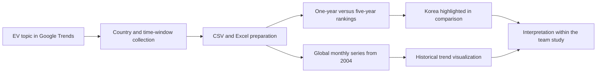
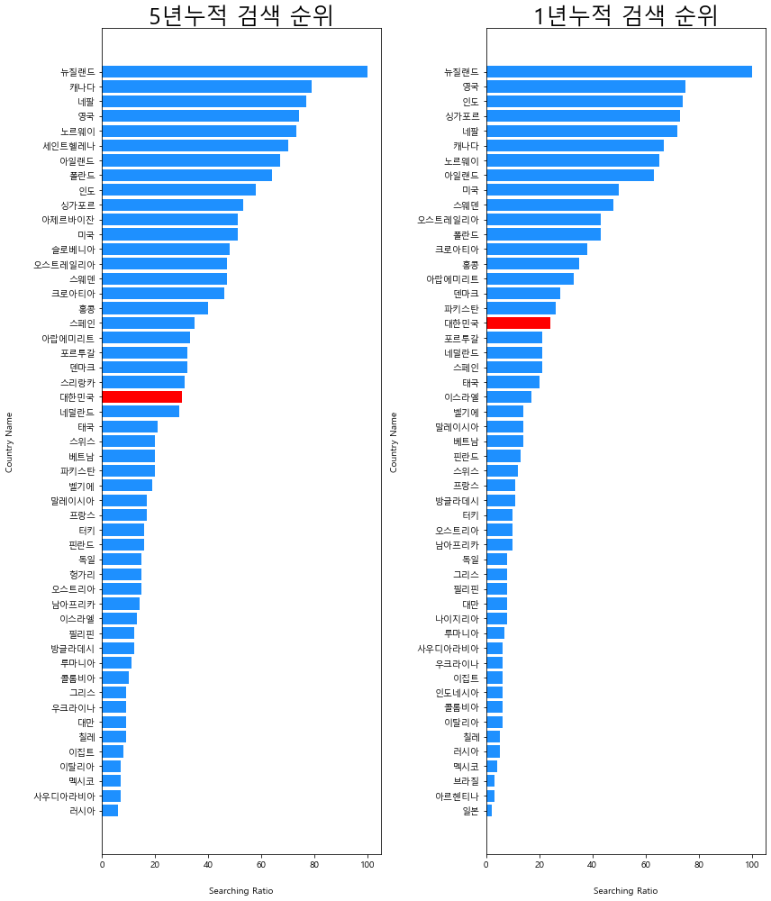
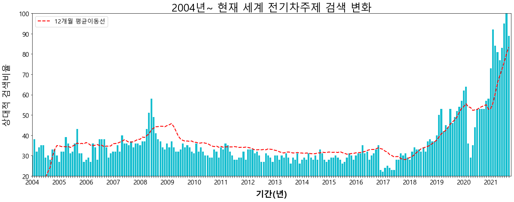

  

# Electric Vehicle Market Analysis in Korea

**Search interest, adoption questions, and infrastructure context**

MultiCampus · K-Digital Training · July–August 2021, as recorded in the project brief

[Portfolio home](../README.md) · [Results & sources](../docs/PROJECT_EVIDENCE.md#electric-vehicle-analysis) · [Reproduction guide](../docs/REPRODUCIBILITY.md#electric-vehicle-analysis) · [Complete catalog](../docs/NOTEBOOK_CATALOG.md)

---

## At a glance

| Item | Description |
|---|---|
| **Team question** | Is Korea's EV adoption being supported by appropriate charging infrastructure and policy? |
| **My analytical focus** | Annual and country-level Google search-interest trends, with Korea highlighted in international comparisons. |
| **Preserved deliverables** | Collection notebooks, comparative country charts, a long-term global series, and development notes. |
| **Main tools** | Python, pandas, NumPy, Matplotlib, Requests, BeautifulSoup, Selenium, and Excel input/output. |
| **Recognition** | Excellent Project Achievement for data analysis/visualization, recorded in my 2023 CV. |
| **Review status** | Source and saved charts inspected; the historical input exports and an end-to-end rerun are not available from this review. |

## Problem and project context

The team framed two questions: **could charging infrastructure keep up with increasing EV adoption, and were policies aligned with that growth?** The original portfolio notebook distributes the investigation across charging stations, vehicle economics, charging loads, regional registration, and public interest.

My part examined public interest through Google Trends. I collected country-level interest rankings, compared one-year and five-year windows, and visualized the global EV-topic series over time. These artifacts provide a concrete, readable part of the broader market study.

The later project brief also describes electricity-demand analysis, highway-rest-stop infrastructure, ownership-cost comparisons, and policy recommendations. Those are broader team outcomes; this folder principally preserves the search-trend work and a supporting YouTube collection notebook.

## Team roles preserved in the notebook

The original [comparison notebook](<portfolio_team1 천준_5y-1y비교.ipynb>) names the team as **데이터, 날 이끌어 조** and records these roles:

| Team member | Recorded responsibility |
|---|---|
| 권미숙 | Highway-rest-stop charging infrastructure and relationships between station/rest-stop sales and charger counts. |
| 김병석 | EV versus internal-combustion ownership economics, including purchase price, subsidies, maintenance, and vehicle tax. |
| 이우림 | YouTube search analysis, charging-related seasonal/hourly electricity loads, and regional subsidy application rates. |
| **천준 / Joon Chun** | **Global, country-level, and Korean EV Google search-trend analysis and visualization.** |
| 홍효석, team leader | Korean EV growth, regional charging stations, and vehicle-registration analysis. |

This direct role record is more specific than treating every team component as one person's implementation.

## Data and analytical workflow

This diagram summarizes the preserved analytical workflow. It does not imply that the original external data exports are included in the Git repository.

### 1. Topic-based collection

The collection code uses the Google Trends **electric-vehicle topic identifier** `/m/01pmdg`. The notebook explains the motivation: a topic query avoids relying only on a single language's spelling of “electric vehicle.”

Selenium opens the page, and BeautifulSoup extracts country names and displayed interest values. The code handles the ranking table's pagination and organizes the extracted values into a DataFrame with ranking, country name, and search-interest fields.

### 2. Country comparison

The analysis reads one-year and five-year Excel exports, assigns Korea a contrasting color, and produces side-by-side horizontal bar charts. The original notebook removes six rows from the five-year export to align displayed list lengths. A future reconstruction should align countries explicitly rather than assume list lengths establish comparable samples.

### 3. Long-term trend exploration

The global-series notebook reads a monthly CSV, adds year labels beginning in 2004, and plots the raw search-interest bars together with an intended twelve-month smoothing line. The saved figure extends to the 2021 project period; “current” in its original title refers to that historical endpoint.

## Archived result gallery

### International rankings: one year and five years

  

*Original saved figure, comparison notebook, cell 29. Left: five-year rankings. Right: one-year rankings. South Korea is highlighted in red. The figure was extracted without recalculating or changing the data.*

The notebook interprets Korea as moving upward in the shorter-window comparison and discusses its position relative to other countries. The defensible observation is about **relative search interest within the exported windows**; the chart does not measure absolute search counts, EV ownership, or purchase intention.

### Global EV-topic interest, 2004–2021

*Original saved figure, global-series notebook, cell 19. The bars preserve the historical search-interest series. The red curve is the original smoothing implementation; see the implementation note below.*

The saved chart shows substantial variation across the period and a strong rise toward its 2021 endpoint. The notebook discusses a change around 2017. Establishing a policy, technology, or economic cause would require additional evidence beyond this chart.

## How to interpret the findings

Google explains that Trends values are normalized to the selected geography and time range and scaled from **0 to 100**. Equal scores in different regions do not establish equal total search volumes, and search interest is not polling data. [Google Trends data FAQ](https://support.google.com/trends/answer/4365533?hl=en)

That distinction matters for this project:

- A higher score is a stronger relative interest signal within its query context.
- Independently normalized one-year and five-year exports need careful comparison.
- Interest, registrations, purchases, charging demand, and infrastructure coverage are different quantities.
- The search-trend module can complement the team's infrastructure analysis, but cannot replace it.

## Recommended reading order

This is a suggested sequence for understanding the archive, not a tested sequential execution recipe.

| Step | Notebook | Why read it |
|---|---|---|
| 1 | [Portfolio: one-year/five-year comparison](<portfolio_team1 천준_5y-1y비교.ipynb>) | Team framing, contributor roles, collection flow, comparative chart, and reflections. |
| 2 | [Portfolio: global trend](<portfolio_team1 천준_세계추의.ipynb>) | Long-term global series, year labeling, historical smoothing, and interpretation. |
| 3 | [Automated Google Trends collection](crawling_google_trends_electric_vehicle_automation.ipynb) | Time-window and topic parameters, collection logic, and table pagination. |
| 4 | [Twelve-month collection variant](<crawling_google_trends_electric_vehicle_12개월.ipynb>) | A narrower example of the collection task. |
| 5 | [Visualization comparison](Visualization_google_trend_5y-1y.ipynb) | Compact comparison-chart construction. |

<b>Additional development notebooks</b>

| Artifact | Role visible in the archive |
|---|---|
| [Crawler structure building](crawling_google_trends_stracture_building.ipynb) | Early selector, topic, and table-extraction experiments. |
| [Visualization structure building](Visualization_google_trend_strcture_building.ipynb) | Country color assignment and chart preparation. |
| [Global-series exploration](<17년 세계전기차주제 검색 상대적 추의.ipynb>) | Standalone long-term-series preparation and visualization. |
| [Global-series structure building](<17년 세계전기차주제 검색 상대적 추의(structure building).ipynb>) | Intermediate structure-building version. |
| [YouTube ranking analysis](Code_blocks/2021_08_20_youtube_rangking_analysis.ipynb) | Supporting browser-based collection experiment. |

There are ten additional tracked checkpoint notebooks across the root and `Code_blocks/`. They are listed separately in the [catalog](../docs/NOTEBOOK_CATALOG.md).

## Reproduction and implementation notes

| Requirement | What the archive references |
|---|---|
| Source exports | Google Trends CSV/Excel files under historical `c:/My_data/` locations. |
| Browser collection | A local ChromeDriver, browser automation, page selectors, and network access. |
| Plotting | Matplotlib and a Korean-capable font for country names and chart labels. |
| Excel support | A compatible pandas Excel reader/writer engine. |

**Historical smoothing detail:** the global-series implementation adds the `a3` lag twice while dividing by twelve. It also starts earlier lags at zero. Consequently, the saved red line should not be described as a freshly validated conventional twelve-observation moving average. The archive and figure are preserved; the evidence location is recorded in the [source register](../docs/PROJECT_EVIDENCE.md#electric-vehicle-analysis).

**Historical scope detail:** the final notebook's reflections say that a Django ownership-cost site and an adoption forecast were desired extensions, rather than completed outputs of this preserved module. The public overview therefore emphasizes the work actually present.

For data preparation and execution boundaries, use the [reproduction guide](../docs/REPRODUCIBILITY.md#electric-vehicle-analysis).

## What this project demonstrates

- Turning a broad public-policy question into a focused, measurable analytical module.
- Collecting topic-based web data and organizing country-level outputs.
- Presenting comparisons with deliberate visual emphasis and explicit units.
- Connecting individual analytical responsibility with a broader team investigation.
- Identifying the limits of a proxy variable and preserving implementation details for later review.

---

[← Portfolio](../README.md) · [Next: health prediction →](../BP_BG_prediction-Machine_Deep_Learning/README.md)
