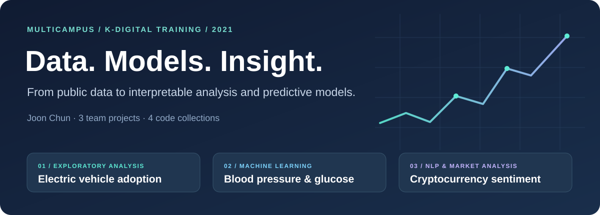

<p align="center">
  
</p>

<h1 align="center">Advanced Data Projects · MultiCampus</h1>

<p align="center">
  <b>A 2021 project portfolio by Joon Chun</b><br>
  Exploratory analysis · Machine learning · Natural language processing · Data engineering
</p>

<p align="center">
  <a href="#project-portfolio">Projects</a> ·
  <a href="#my-contribution">My contribution</a> ·
  <a href="#explore-the-archive">Start reading</a> ·
  <a href="docs/REPRODUCIBILITY.md">Reproduction guide</a> ·
  <a href="docs/PROJECT_EVIDENCE.md">Sources &amp; results</a>
</p>

---

## About this portfolio

This repository preserves work from my **Data Science & Engineering Professional Program at MultiCampus**, completed through K-Digital Training in **July–December 2021**. My résumé records an **844-hour program** combining data analysis, machine learning, and engineering practice.

The projects progress from collecting and explaining public data, to comparing predictive models on health records, to combining text sentiment with cryptocurrency market indicators. They show how I approached a problem, worked within a team, developed analytical methods, and connected results to a user-facing project concept.

**Three team projects are represented in four code collections.** The two cryptocurrency folders contain research and integration work from the same final project; their READMEs explain how they fit together.

> **Reading this archive:** the code and saved notebook outputs are historical project artifacts. The updated documentation distinguishes results reported in my project briefs from values visible in the archive. A fresh end-to-end execution has not been completed during this documentation review. See [evidence and provenance](docs/PROJECT_EVIDENCE.md) for the precise boundaries.

## Project portfolio

| Project | Question and approach | My contribution | Explore |
|---|---|---|---|
| **01 · Electric vehicle market analysis** | How does interest in EVs vary across countries and over time, within a broader study of Korea's adoption and charging infrastructure? Google Trends collection, comparative charts, and long-term trend exploration. | Google search-trend collection and visualization; the original team notebook explicitly assigns this work to me. | [Project overview](Electric_vehicle_trend-Visualization_Analysis/README.md) |
| **02 · Blood pressure & glucose prediction** | What can demographic, body-measurement, and lifestyle features reveal about blood pressure and fasting glucose? NHIS health data, feature engineering, regression, and classification. | Team leadership and blood-pressure modeling, recorded in my project brief; this archive also contains detailed glucose-model experiments. | [Project overview](BP_BG_prediction-Machine_Deep_Learning/README.md) |
| **03 · Cryptocurrency sentiment & market analysis** | Can text sentiment and statistical price indicators provide complementary views of cryptocurrency behavior? English/Korean NLP, LSTM models, sentiment indices, and recommendation logic. | Overall project design, statistical analysis, recommendation work, and collaboration on sentiment AI, recorded in my project materials. | [Research collection](cryptocurrency_sentiment-Deep_Learning/README.md) · [Data & Korean NLP](crypto_market_prediction_project-DB_DL_combined/README.md) |

### 01 · From search interest to an EV market story

The EV project combines a broad team question about adoption and infrastructure with my focused analysis of **public search interest**. The archive includes automated country-ranking collection, side-by-side one-year/five-year charts, and a long-term global series beginning in 2004.

**What to look for:** topic-based search collection, geographic comparison, Korea highlighted within international rankings, and the limits of using search interest as an adoption proxy.

→ [Read the project](Electric_vehicle_trend-Visualization_Analysis/README.md) · [Open the comparison notebook](<Electric_vehicle_trend-Visualization_Analysis/portfolio_team1 천준_5y-1y비교.ipynb>)

### 02 · From health records to model evaluation

The health project explores how basic personal measurements and lifestyle variables can support an educational prediction prototype. Its preserved experiments cover **BMI/ABSI features, outlier handling, scaling, linear models, decision trees, random forests, and glucose classification**.

**What to look for:** the difference between predicting a continuous glucose value and classifying a threshold, how feature choices change the task, and how saved results relate to the final project report.

→ [Read the project](BP_BG_prediction-Machine_Deep_Learning/README.md) · [Open the consolidated glucose notebook](<BP_BG_prediction-Machine_Deep_Learning/(종합)혈당수치예측_천준.ipynb>)

### 03 · From community text to market indicators

The final project develops the **Galdae / 갈대** sentiment-model concept and connects it with statistical market analysis. The research collection contains English NLP, sentiment-index experiments, moving-average/z-score work, time-series models, preference-based ranking, and visualization code. The second collection preserves **Coinpan crawling and Korean LSTM classification**.

**What to look for:** the text-processing pipeline, three-class sentiment models, sentiment-volume indices, price-deviation measures, database interfaces, and the distinction between sentiment accuracy and market-direction success.

→ [Read the research collection](cryptocurrency_sentiment-Deep_Learning/README.md) · [Read the integration collection](crypto_market_prediction_project-DB_DL_combined/README.md)

## My contribution

| Area | Work represented in this portfolio |
|---|---|
| **Problem framing** | Connecting an EV infrastructure question, an accessible health-estimation concept, and a hybrid sentiment/statistics market-analysis concept to concrete analytical work. |
| **Analysis & modeling** | Search-trend visualization, health feature exploration and model comparisons, sentiment-index design, statistical price indicators, and recommendation logic. |
| **Team collaboration** | An explicitly documented search-trend role in the EV team; leadership and analytical responsibilities in the health and cryptocurrency projects, described in my résumé and project briefs. |
| **Data-to-product thinking** | Organizing collected information and model outputs for charts, database tables, and historical web-prototype concepts. The complete web applications are not preserved in this repository. |

**Recognition:** my 2023 CV records **Excellent Project Achievement** recognition at MultiCampus for both the data-analysis/visualization project and the machine/deep-learning project. This is author-provided background; the source trail is documented [here](docs/PROJECT_EVIDENCE.md#author-provided-background).

## Methods and tools in the archive

| Layer | Observed tools and methods |
|---|---|
| Data collection | Requests, BeautifulSoup, Selenium; CSV and Excel inputs |
| Data preparation | pandas, NumPy, regular expressions, NLTK, KoNLPy/Okt |
| Statistical analysis | SciPy, statsmodels, correlation analysis, moving averages, standard deviations, z-scores |
| Machine learning | scikit-learn regression/classification, decision trees, random forests, feature scaling |
| Deep learning | TensorFlow/Keras embeddings, LSTM models, model checkpoints, early stopping |
| Visualization | Matplotlib, Seaborn, Plotly, Cufflinks, pyecharts |
| Database interfaces | PyMySQL and SQLAlchemy in archived MySQL workflows |

This table describes imports and methods found in the saved code. It is not a tested dependency lockfile. MongoDB/AWS and web-platform work appear in the broader project brief and are distinguished from the local artifacts in the detailed documentation.

## Explore the archive

**For a portfolio review**, read the project overviews first, then follow each project's recommended notebook sequence. **For a technical review**, pair those notebooks with the [evidence register](docs/PROJECT_EVIDENCE.md) and [reproduction guide](docs/REPRODUCIBILITY.md).

```text
AdvancedDataProjects-MultiCampus/
├── README.md
├── Electric_vehicle_trend-Visualization_Analysis/   # EV search-trend analysis
├── BP_BG_prediction-Machine_Deep_Learning/          # Health-model experiments
├── cryptocurrency_sentiment-Deep_Learning/         # NLP & market research
├── crypto_market_prediction_project-DB_DL_combined/ # Crawling & Korean NLP
├── assets/readme/                                   # Covers & archived figures
├── docs/
│   ├── PROJECT_EVIDENCE.md                           # Sources, roles & metrics
│   ├── REPRODUCIBILITY.md                            # Data & execution boundaries
│   └── NOTEBOOK_CATALOG.md                           # Complete artifact index
└── memory/                                          # Maintainer continuity records
```

| Collection | Notebooks, excluding checkpoints | Python scripts | Standalone original figures |
|---|---:|---:|---:|
| Electric vehicle analysis | 10 | 0 | 0 |
| Health prediction | 9 | 0 | 6 |
| Cryptocurrency research | 33 | 0 | 0 |
| Cryptocurrency integration | 2 | 4 | 0 |
| **Total** | **54** | **4** | **6** |

There are also **13 tracked checkpoint notebooks**, retained as historical copies. Their presence does not establish equivalence to the other versions. The [complete catalog](docs/NOTEBOOK_CATALOG.md) lists all 67 notebooks and the four scripts.

## Reproduction at a glance

| Project | External material referenced by the code | Current documentation-review status |
|---|---|---|
| EV analysis | Google Trends CSV/Excel exports and a local ChromeDriver | Saved charts and collection code inspected; source exports are not tracked here. |
| Health prediction | A 2017 NHIS health-check CSV referenced in the notebooks | Code and selected saved results inspected; local 2020 files are not verified substitutes. |
| Cryptocurrency research | Labeled text, price data, model/array files, and database tables | Research flow and selected outputs inspected; external artifacts are required for execution. |
| Cryptocurrency integration | Korean labeled Excel files, model files, database configuration, community pages | Crawling and model code inspected; crawlers have external read/write effects. |

Start with [REPRODUCIBILITY.md](docs/REPRODUCIBILITY.md) before executing cells. The health project is an educational modeling archive; the cryptocurrency project is a historical research/prototype archive. Neither README establishes clinical validation, investment performance, or a currently running service.

## Credits and documentation

These projects were developed in a team-learning setting at MultiCampus. The project READMEs preserve specific contribution distinctions, including the named roles in the EV notebook and collaborator attribution in the sentiment experiments.

- [Project context, reported results, and archive evidence](docs/PROJECT_EVIDENCE.md)
- [Data, dependencies, and reproduction notes](docs/REPRODUCIBILITY.md)
- [Complete notebook and script catalog](docs/NOTEBOOK_CATALOG.md)
- [Figure provenance](assets/readme/SOURCES.md)
- [2026 maintenance and validation](docs/REPAIRS.md)

Documentation reorganized in October 2026 from the original artifacts and author-provided background. The original notebook filenames, saved outputs, and project directories are preserved.
