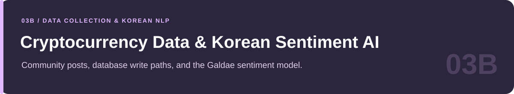
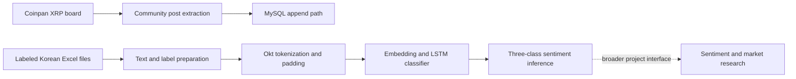

<p align="center">
  
</p>

# Cryptocurrency Data Collection & Korean Sentiment AI

**Coinpan collection, database write paths, and the Galdae / 갈대 LSTM model**

MultiCampus · K-Digital Training · Part of the October–December 2021 cryptocurrency project

[Portfolio home](../README.md) · [Companion: NLP & market research](../cryptocurrency_sentiment-Deep_Learning/README.md) · [Results & sources](../docs/PROJECT_EVIDENCE.md#cryptocurrency-integration) · [Reproduction guide](../docs/REPRODUCIBILITY.md#cryptocurrency-integration)

---

## At a glance

| Item | Description |
|---|---|
| **Collection purpose** | Preserve community-data collection and Korean sentiment-model work supporting the broader cryptocurrency analysis project. |
| **Source represented in the crawlers** | Coinpan community posts; the visible crawler configuration targets the XRP board. |
| **Text model** | Korean preprocessing and a three-class embedding/LSTM/softmax classifier. |
| **Model name** | 갈대, rendered here as **Galdae** and also described as “Reed” in earlier project prose. |
| **Preserved artifacts** | Two model-development notebooks and four Python files. |
| **Review status** | Source and selected training/evaluation logs inspected; no crawler, database writer, or model training was executed for documentation. |

## How this folder fits the final project

The companion [research collection](../cryptocurrency_sentiment-Deep_Learning/README.md) contains English NLP, sentiment-index formulas, statistical price analysis, recommendation experiments, and visualization work.

This folder contains a more focused set of artifacts: **collect Korean community posts, prepare labeled Korean text, train a sentiment model, and preserve an inference function and database write paths**. It is part of the same capstone, rather than an unrelated fourth portfolio project.

The author's project brief records overall framework design, statistical analysis, and collaboration on sentiment AI. The archived files establish specific implementations and prototypes; they do not establish sole ownership of every team artifact.

## Preserved component flow



The crawler and training inputs are distinct artifacts. The diagram does not assert that raw crawled posts become a verified training dataset automatically, or that the complete historical deployment can be reproduced from these six files alone.

## 1 · Community-data collection

| Script | Observed scope | External effects |
|---|---|---|
| [coinpan_crawling.py](coinpan_crawling.py) | XRP-board pagination from page 1 through page 1200 via `range(1, 1201)`; collects post information using Requests and BeautifulSoup. | Network requests and an SQL append path to `coinpan_xrp`. |
| [coinpan_index_c.py](coinpan_index_c.py) | A shorter XRP-board variant using `range(0, 10)`. | Network requests and an SQL append path to the same table name. |

These scripts contain **top-level work**, rather than an isolated command-line interface guarded by `if __name__ == '__main__'`. Importing or running them is not a read-only inspection. The first crawler's engine calls include empty connection-string placeholders, so historical database configuration must be restored deliberately before reuse.

The two files should be understood as preserved collection variants. Their names do not prove one is a duplicate or that either is currently scheduled.

## 2 · Korean labeled-data preparation

The representative [K갈대 model notebook](<갈대 AI/K갈대_AI_최적화.ipynb>) reads four external Excel files:

| Input | Meaning established by the file reference |
|---|---|
| `alt.xlsx` | Labeled material for the altcoin collection. |
| `btc.xlsx` | Labeled Bitcoin-related material. |
| `eth.xlsx` | Labeled Ethereum-related material. |
| `xrp.xlsx` | Labeled XRP-related material. |

The notebook combines data, joins title and body text, removes unrelated class `3`, and retains the documented sentiment mapping **0 = positive, 1 = neutral, 2 = negative**.

Its preparation includes Korean-character filtering, **Okt morphological tokenization**, stopword removal, vocabulary filtering, removal of empty sequences, and padding. The split uses **20% test data**, `random_state=2045`, and label stratification.

The notebook also saves and reloads NumPy arrays and a tokenizer word-index dictionary. A valid rerun must keep those arrays, the vocabulary, the label definition, and the trained model consistent.

## 3 · LSTM model and parameter exploration

The preserved classifier has this core structure:

```text
Korean text
   ↓ cleaning + Okt + stopword removal
Integer token sequence
   ↓ vocabulary filtering + padding, max_len=100
Embedding
   ↓
LSTM
   ↓
Dense(3, activation="softmax")
   ↓
Positive / neutral / negative classification
```

The optimization notebook explores embedding dimensions **12, 25, 50, 100**, hidden-unit counts **8, 16, 32, 64**, and batch sizes **16, 32, 64, 128**. Its loop requests up to 400 epochs with early stopping and model checkpoints. A later separate configuration uses an embedding dimension of 100 and 128 LSTM units.

The model is compiled with **RMSprop**, **sparse categorical cross-entropy**, and **accuracy**. The model-selection files are referenced outside the repository and are not bundled model deliverables.

## Results visible in the archive

| Saved observation | Source | Interpretation |
|---|---|---|
| `loss: 1.1295`, `acc: 0.5391` | K갈대 notebook, cell 73 | A saved evaluation of a separately loaded model; the printed accuracy uses `evaluate(...)[1]`. |
| `loss: 1.0226`, `acc: 0.5571` | Final displayed evaluation in the optimization-loop output, cell 68 | One displayed configuration from the loop; not a claim that this is the best model overall. |

These figures describe **Korean three-class sentiment classification**, not the project's reported market-direction success rate. Model checkpoints and the exact prepared arrays would be needed to reproduce them.

The project's broader historical outcomes are documented in the [research README](../cryptocurrency_sentiment-Deep_Learning/README.md#reported-capstone-outcomes) and [evidence register](../docs/PROJECT_EVIDENCE.md#cryptocurrency-research).

## 4 · Inference and exploratory script exports

The model notebook contains `sentiment_predict(...)`, which prepares incoming title/body text, applies the saved word index, pads sequences, and includes sentiment prediction work. It illustrates how trained text preparation could support the wider project.

The long Python model file preserves similar notebook-style development work, including file loads, training/model selection, and inference helpers. It should be read as an experimental export rather than assumed to be a clean importable package.

The 2026 maintenance pass retained notebook-only `!pip` commands as comments in
both exported Python files, making their source parseable as Python. This does
not establish compatible dependencies, restored input files or successful
training/API access. `datetime`, `ftplib`, `io` and `json` in the archived
installation notes are standard-library modules; do not install similarly named
packages merely because an old notebook command lists them. See the
[maintenance record](../docs/REPAIRS.md).

## File-by-file guide

| File | What it preserves | Suggested use |
|---|---|---|
| [coinpan_crawling.py](coinpan_crawling.py) | Longer XRP-board collection and SQL append path. | Read collection bounds, extracted fields, and write destination before considering a run. |
| [coinpan_index_c.py](coinpan_index_c.py) | Shorter board-pagination variant. | Compare the collection variant without assuming it is safely importable. |
| [K갈대_AI_최적화.ipynb](<갈대 AI/K갈대_AI_최적화.ipynb>) | Korean data preparation, optimization loop, evaluation, and inference work. | Primary reading entry point for the Korean sentiment model. |
| [1-1. wikidocs.net_44249 최적화.ipynb](<갈대 AI/1-1. wikidocs.net_44249 최적화.ipynb>) | Related development variant with similar preprocessing/model imports. | Historical comparison; its filename records a tutorial reference, not a verified final-model designation. |
| [갈대_AI_LSTM_최적화.py](<갈대 AI/갈대_AI_LSTM_최적화.py>) | Long model-development export with preparation and inference helpers. | Inspect as an experimental script before execution. |
| [yahoo_fin_ex.py](<갈대 AI/yahoo_fin_ex.py>) | A `yahoo_fin.stock_info` market-data example. | Supporting exploration, separate from sentiment evaluation. |

## Recommended reading sequence

1. Read the [companion research overview](../cryptocurrency_sentiment-Deep_Learning/README.md) to understand the capstone's analytical design.
2. Inspect `K갈대_AI_최적화.ipynb` for data labels, text preparation, model structure, and evaluation logs.
3. Compare the related model notebook and exported Python file as development variants.
4. Read the two crawler scripts as external-effecting collection code, including their pagination and database paths.
5. Consult [REPRODUCIBILITY.md](../docs/REPRODUCIBILITY.md#cryptocurrency-integration) before restoring any data/model/database environment.

## Reproduction boundaries

| Dependency or boundary | What must be established before execution |
|---|---|
| Korean labels | Obtain the four referenced spreadsheets and check label/schema consistency. |
| Morphological analysis | Restore a compatible KoNLPy/Okt and Java environment. |
| Model artifacts | Match the vocabulary dictionary, prepared arrays, and `.h5` model used by the evaluation/inference cells. |
| Historical paths | Replace Colab/local absolute paths in a working copy; retain the original archive. |
| Database | Supply an owned test database and explicit connection/table configuration. |
| Crawling | Review the current site interface and collection conditions before making network requests. |
| Evaluation | Use validation for selection and keep a separate final test set; document which checkpoint is evaluated. |

No live service, complete web application, or current market-data collection schedule is verified by this collection. The source files and saved outputs were preserved during documentation work.

---

[← Companion research](../cryptocurrency_sentiment-Deep_Learning/README.md) · [Portfolio home](../README.md)
