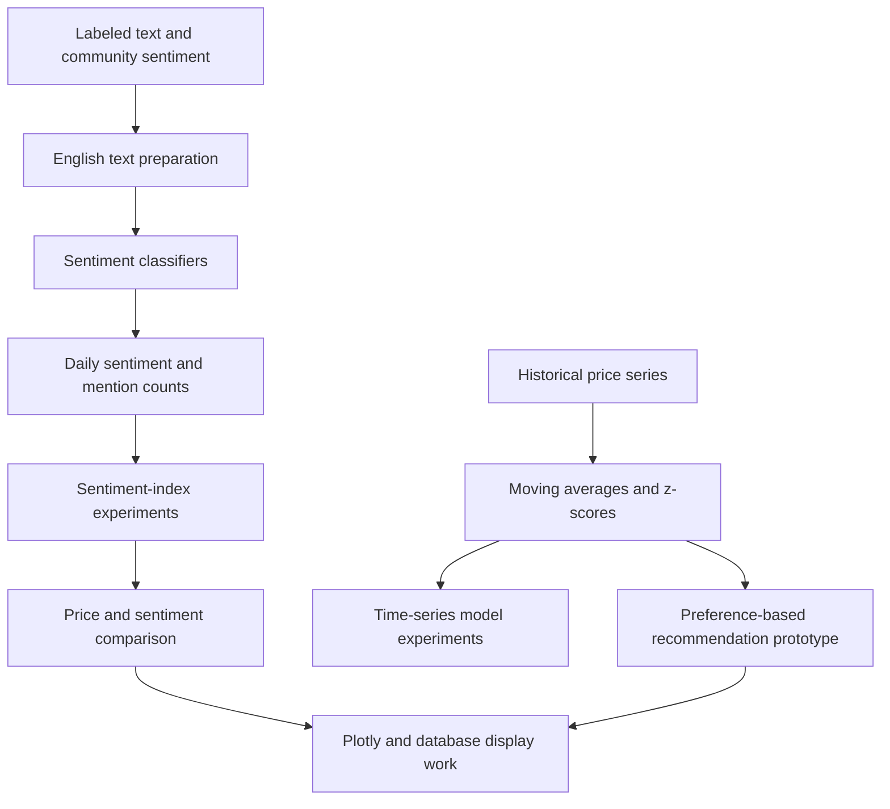
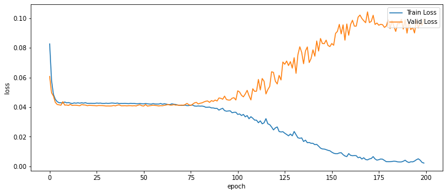
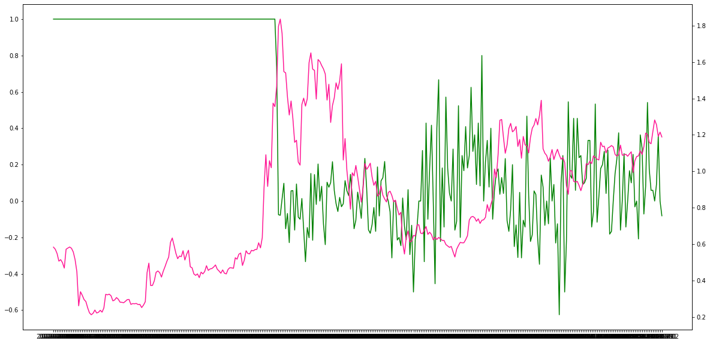

<p align="center">
  
</p>

# Cryptocurrency Sentiment & Market Research

**English NLP, sentiment indices, statistical price analysis, and recommendation experiments**

MultiCampus · K-Digital Training · October–December 2021, as recorded in the project brief

[Portfolio home](../README.md) · [Companion: data & Korean NLP](../crypto_market_prediction_project-DB_DL_combined/README.md) · [Results & sources](../docs/PROJECT_EVIDENCE.md#cryptocurrency-research) · [Reproduction guide](../docs/REPRODUCIBILITY.md#cryptocurrency-research)

---

## At a glance

| Item | Description |
|---|---|
| **Project concept** | Combine social/community sentiment with statistical market indicators to investigate cryptocurrency behavior. |
| **This collection** | The research side of the final team project: English text processing, sentiment models, sentiment-index formulas, price models, recommendations, and visualization/database experiments. |
| **Companion collection** | Coinpan crawling, database write paths, and Korean LSTM sentiment classification. |
| **My recorded role** | Overall framework design, statistical analysis, recommendation work, and collaboration on sentiment AI, described in my résumé and project brief. |
| **Preserved artifacts** | 33 notebooks and two Markdown development notes. |
| **Review status** | Source and selected saved outputs inspected; model weights, source datasets, and historical database services are external dependencies. |

## Why combine text and market data?

The project explored a complementary approach: **text describes expressed sentiment, while price statistics describe how far a market has moved from a local reference**. The project brief describes a hybrid framework using sentiment analysis and Bollinger-band/statistical ideas, with a recommendation and web-display layer.

The archive makes that concept concrete through several experimental modules. They are related pieces of one capstone rather than a single fully packaged application. Model training, market forecasting, recommendation scoring, and graph export should be read as separate tasks with separate evidence.

### Contribution and collaboration

My project materials record responsibility for the overall concept and statistical analysis, plus collaboration on AI models. The recommendation and sentiment-index artifacts expose the mathematical and data-processing side of that work.

The English LSTM optimization notebook explicitly begins with **“김승현님 작업”**. That collaborator attribution is preserved: the sentiment-model collection is team work, and a notebook's presence here is not a claim of sole authorship.

## Module map



This is a documentation map of the related artifacts. It is not evidence that every module is connected in a currently running service.

## 1 · English text processing and sentiment models

The preserved work includes lexicon-oriented exploration, text cleaning, tokenization/embedding preparation, dense/convolutional experiments, and an LSTM classifier.

| Stage | Observed implementation |
|---|---|
| Cleaning | URLs, handles, emoji, HTML tags, special codes, and non-letter patterns are handled in the English preprocessing experiments. |
| Language preparation | NLTK stopword and WordNet-related processing, tokenization, and contraction handling appear in the code. |
| Train/test division | The representative LSTM optimization notebook uses a stratified 80/20 split with `random_state=1004`. |
| Sequence representation | A fitted Keras tokenizer, vocabulary filtering, removal of empty samples, and padded sequences; the representative maximum length is 30. |
| LSTM classifier | `Embedding` → `LSTM` → a three-output softmax layer. One saved configuration uses embedding dimension 400 and 256 hidden units. |
| Training | RMSprop, sparse categorical cross-entropy, accuracy logs, early stopping, and model checkpoints. |

The three-class models in the archive should not be conflated with the broader project's five-level sentiment/trade-display descriptions.

### A precise reading of the saved sentiment results

In [the English LSTM optimization notebook](<갈대 AI/(eng)AI최적화mbsa3.ipynb>), cells 43–47 print `evaluate(...)[0]` with an “accuracy” label. The logged metric line shows that this returned value is **loss**, while the actual accuracy is logged as `acc`.

| Notebook cell | Logged loss | Logged accuracy | Value printed as “test accuracy” |
|---|---:|---:|---:|
| 43 | 0.6217 | 0.6837 | 0.6217 — loss |
| 44 | 0.6704 | 0.6778 | 0.6704 — loss |
| 45 | 0.8045 | 0.6961 | 0.8045 — loss |
| 46 | 0.6952 | 0.6864 | 0.6952 — loss |
| 47 | 0.6699 | 0.6765 | 0.6699 — loss |

These are recorded model-evaluation outputs. They are not a fresh test, a canonical model ranking, or evidence of market-direction accuracy. The paired Korean-named optimization notebook preserves the same labeling issue in its corresponding cells.

## 2 · Sentiment-index design

The [sentiment-index design note](Sentiment_index/감정지수화.md) records the research motivation: summarize sentiment while considering its change, mention volume, and a price reference. It also explicitly treats mean reversion and its behavioral interpretation as assumptions requiring investigation.

The [XRP index notebook](<Sentiment_index/감정지수화(XRP).ipynb>) develops related candidate formulas:

| Candidate | Concept visible in the code |
|---|---|
| `S_index1` | Sentiment measure multiplied by mention count. |
| `S_index2` | A weighted combination of sentiment and its first/second change terms, multiplied by count. |
| `S_index3` | Sentiment/change terms combined with count/change terms. |

For example, the second formula uses equal `1/3` coefficients in the archived cell. These are experimental design choices, not coefficients established by an independent prediction test.

Separate notebooks explore XRP, BCH, BTC, ETH, and OMG, compare series, and inspect correlations. The existence of these analyses does not establish a causal relationship between sentiment and price.

## 3 · Price indicators and LSTM time-series experiments

The price notebooks explore rolling means, rolling standard deviations, and standardized price deviations. The model variants are organized around **7-, 14-, 30-, and 60-period moving-average experiments**.

In [the MA14 variant](<Price_prediction_AI/Time_series_analysis_cryptocurrency_LSTM_AI_MA14(GPU).ipynb>), the saved code uses:

- A Bitcoin CSV as an input, with date/price/volume preparation.
- Rolling means and standard deviations followed by negative shifts.
- A min-max transformation to `[-1, 1]`.
- A sequence look-back of **28 observations**.
- An LSTM with **128 units** and a single `tanh` output.
- Mean squared error, 200 requested epochs, and batch size 16.

### Training behavior preserved in the archive



*Original saved plot, MA14 notebook, cell 48. The blue training loss decreases while the orange validation loss rises later in training.*

Cell 50 records **training loss 0.0018862** and **test loss 0.0994576** on the transformed target. The same test sequence is passed as validation data during fitting. These values describe that saved experiment and are not raw-price forecasting errors or an untouched final-holdout result.

The divergence in the plotted curves is consistent with overfitting. A fresh evaluation would also need to establish chronological order, check shifted-feature causality, fit transformations only on training data, and separate validation from final testing.

## 4 · Recommendation logic

The [recommendation notebooks](Recommendation/) explore coin selection according to a user's desired fluctuation level. The preserved final prototype computes summaries of standardized price deviations over different windows, ranks assets, and chooses a candidate closest to the input preference.

One visible scoring function is:

```python
Ranking = -abs(zvalue - alevel) + len(crypto)
```

This is a **preference-matching prototype**, not a portfolio optimizer or a verified profitable trading strategy. It depends on external database tables and notebook state. The final notebook also contains duplicated `BTC` entries and revised/overlapping function definitions, so its title alone does not establish a production-ready implementation.

## 5 · Visualization and database experiments

The price/sentiment graph notebooks combine price with English and Korean positive-sentiment ratios using Plotly traces, date sliders, and multiple axes. Other cells prepare and update database tables. The bubble-chart and presentation notebooks preserve additional display experiments.

The author-provided project brief describes a web platform, real-time processing, top-ten cryptocurrency coverage, and MongoDB/AWS. The saved research artifacts examined here include **MySQL/PyMySQL/SQLAlchemy** workflows and graph-building code. A complete frontend, live-service configuration, and end-to-end deployment are not bundled in this collection.

<details>
<summary><b>Additional original price/sentiment figure</b></summary>



*Original saved figure, XRP sentiment-index notebook, cell 49. The plotting cell uses green `Y_values` and pink `X_values` on separate axes and inverts the shared date axis. The figure is preserved as an experiment; its crowded date labels and separate scales limit quantitative visual comparison.*

</details>

## Reported capstone outcomes

The author's cryptocurrency project brief reports approximately **40%-range sentiment-only**, **50%-range statistical-only**, and **80% combined** market-direction success, with a stated 24-hour timeframe and lower signal frequency for the combined method.

Those are **historical author-reported capstone results**. The preserved notebooks reviewed here do not establish the exact evaluation sample, denominator, event selection, cost assumptions, or holdout protocol behind that comparison. They are therefore kept separate from the LSTM sentiment metrics above. The [evidence register](../docs/PROJECT_EVIDENCE.md#cryptocurrency-research) records the source and the differences between résumé and project-brief wording.

## Recommended reading order

| Step | Artifact | What to inspect |
|---|---|---|
| 1 | [Sentiment-index design note](Sentiment_index/감정지수화.md) | Research concept, assumptions, and proposed sentiment/price relationship. |
| 2 | [English preprocessing/model exploration](<(eng) sentiment analysis_mbsa-천준님.ipynb>) | Cleaning functions, token preparation, and early model experiments. |
| 3 | [English LSTM optimization](<갈대 AI/(eng)AI최적화mbsa3.ipynb>) | The three-class sequence model and logged metric interpretation. |
| 4 | [XRP sentiment-index experiment](<Sentiment_index/감정지수화(XRP).ipynb>) | Candidate index formulas, derivatives, mention counts, and plots. |
| 5 | [MA14 time-series model](<Price_prediction_AI/Time_series_analysis_cryptocurrency_LSTM_AI_MA14(GPU).ipynb>) | Price-feature construction, sequence preparation, training behavior, and validation limitations. |
| 6 | [Recommendation prototype](Recommendation/Final_Recommendation_system_cryptocurrency1.ipynb) | Preference matching, ranked deviation measures, and database dependencies. |
| 7 | [XRP price/sentiment graph export](<가격,감정 그래프/Copy of XRP_그래프_2차_시각화밎html저장.ipynb>) | Price/English/Korean sentiment traces and display/export work. |
| 8 | [Mentor feedback, 2021-11-27](<2021.11.27 피트백.md>) | Requests for clearer architecture, sentiment-index validation, and engineering presentation. |

This order is an explanatory path through the research. It does not guarantee that the notebooks execute consecutively.

## Folder guide

| Location | Notebook count | Preserved focus |
|---|---:|---|
| Collection root | 7 | English/lexicon/embedding exploration, preprocessing, MySQL experiments, validation reading, and XRP presentation. |
| [갈대 AI/](<갈대 AI/>) | 2 | English three-class LSTM optimization variants; team attribution is recorded inside. |
| [Sentiment_index/](Sentiment_index/) | 9 | Sentiment formulas, XRP studies, and coin-specific EDA/correlation work. |
| [Price_prediction_AI/](Price_prediction_AI/) | 5 | Price EDA and MA7/MA14/MA30/MA60 LSTM variants. |
| [Recommendation/](Recommendation/) | 4 | Ranking, function development, and final-prototype variants. |
| [가격,감정 그래프/](<가격,감정 그래프/>) | 5 | Database preparation and price/sentiment graph variants. |
| [Bubble charts/](<Bubble charts/>) | 1 | Additional display experiment. |
| **Total** | **33** | Complete filenames are in the [catalog](../docs/NOTEBOOK_CATALOG.md). |

## Reproduction and limitations

The code refers to external labeled text, historical price CSVs, tokenizer dictionaries, NumPy sequence files, HDF5 models, and MySQL tables. Several notebooks assume Colab Drive, GPU-era TensorFlow/Keras APIs, and existing global notebook variables.

The most important interpretation boundaries are:

- **Sentiment classification, regression loss, recommendation matching, and market success are different outcomes.**
- A tokenizer and its model must be matched; external reloaded arrays can change the effective dataset relative to earlier preparation cells.
- Negative rolling shifts need date-order and causal-alignment review before a forecasting claim.
- Training curves and repeated test comparisons do not provide an independent prospective market evaluation.
- The recommendation and database notebooks are prototypes with external state, not one-command applications.

See [REPRODUCIBILITY.md](../docs/REPRODUCIBILITY.md#cryptocurrency-research) before running code. Historical outputs, filenames, and collaborator notes were preserved during this documentation review.

---

[← Health prediction](../BP_BG_prediction-Machine_Deep_Learning/README.md) · [Portfolio](../README.md) · [Companion: data collection & Korean NLP →](../crypto_market_prediction_project-DB_DL_combined/README.md)
